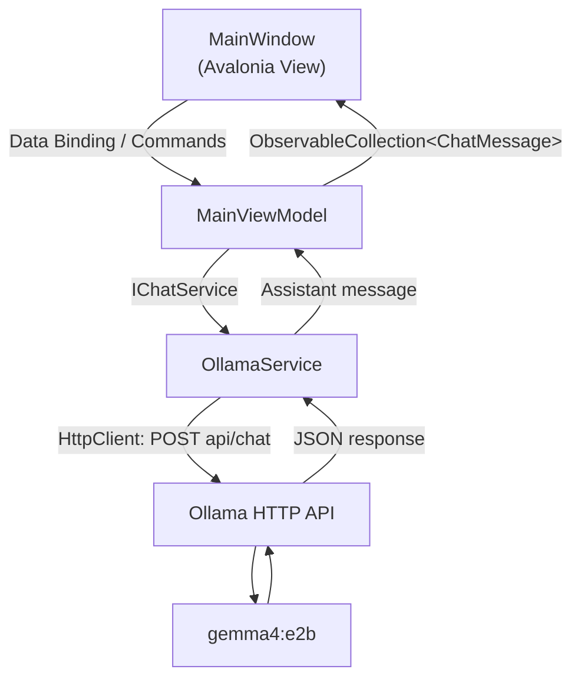

# LocalLlmDesktop

[日本語版 README](README_ja.md)

*This project is a personal learning project focused on building a desktop client for a locally hosted language model.*

## Description

LocalLlmDesktop is a desktop chat application built with C#, .NET, and Avalonia UI. It provides a graphical interface for sending messages to a language model served by [Ollama](https://ollama.com/) through its HTTP API.

The application is designed as a separate client: the language model is not bundled with the application. Ollama runs as an independent service, manages the model, and handles inference requests. LocalLlmDesktop sends the conversation history to Ollama and displays the returned response.

The project was developed to gain practical experience with desktop application development, the MVVM pattern, dependency injection, interface-based service abstraction, asynchronous HTTP communication, and cross-platform publishing with .NET.

## Features

- Send text messages to an Ollama instance through the `/api/chat` endpoint.
- Display user and assistant messages in a conversation view.
- Include the conversation history in subsequent requests.
- Perform HTTP communication asynchronously.
- Display request status and errors in the UI.
- Publish the application for different runtime targets.

### Current implementation scope

The current implementation has the following characteristics:

- The model name is fixed to `gemma4:e2b`.
- Responses are received in non-streaming mode (`stream: false`).
- The Ollama base URL is currently configured directly in `App.axaml.cs`.
- Conversation history is held in memory and is not saved between application sessions.

Model selection, streaming output, persistent conversation storage, and configurable connection settings are not implemented.

## Technology Stack

| Technology | Purpose |
|---|---|
| C# | Application development |
| .NET 10 | Runtime and application framework |
| Avalonia UI 12.1.6 | Cross-platform desktop UI |
| CommunityToolkit.Mvvm 8.4.2 | MVVM source generators and command support |
| `HttpClient` | HTTP communication with Ollama |
| `System.Text.Json` | JSON serialization and deserialization |
| Ollama | Local model serving and inference |
| gemma4:e2b | Configured language model |

## Requirements

- .NET 10 SDK (for building from source)
- Ollama installed and running
- The `gemma4:e2b` model available in Ollama
- A supported desktop environment for the target runtime

The model is managed by Ollama and is not included in this repository or application package.

## Instructions

### 1. Install and prepare Ollama

Install Ollama by following the instructions on the [official Ollama website](https://ollama.com/).

Download the model used by the current implementation:

```bash
ollama pull gemma4:e2b
```

Make sure the Ollama service is running before launching the application. Depending on the operating system and installation method, Ollama may already run as a background service.

### 2. Configure the Ollama endpoint

The current source code sets the base URL in `App.axaml.cs`:

```csharp
_httpClient = new HttpClient
{
    BaseAddress = new Uri("http://172.27.192.1:11434/")
};
```

This address was used in the development environment to connect from WSL2 to an Ollama server running on the Windows host. It is environment-specific and should not be assumed to work on another machine or network configuration.

Change the URL to the address reachable from the application process. For example, when the application and Ollama run on the same host, the endpoint may be:

```csharp
BaseAddress = new Uri("http://127.0.0.1:11434/");
```

If the application runs inside WSL2 while Ollama runs on Windows, configure Ollama to listen on an address reachable from WSL2 and use the corresponding Windows host address. Do not expose the Ollama API to an untrusted network.

The application sends requests to `api/chat` relative to this base URL.

### 3. Build and run from source

Clone the repository:

```bash
git clone <repository-url>
cd LocalLlmDesktop
```

Restore dependencies and build:

```bash
dotnet restore
dotnet build
```

Run the application:

```bash
dotnet run
```

Ensure the configured Ollama endpoint is reachable and the `gemma4:e2b` model is available before sending a message.

### 4. Publish the application

The following examples publish Release builds for Windows and Linux.

Windows, framework-dependent deployment (FDD):

```powershell
dotnet publish -c Release -r win-x64 --self-contained false -o .\artifacts\win-x64-fdd
```

Windows, self-contained deployment (SCD):

```powershell
dotnet publish -c Release -r win-x64 --self-contained true -o .\artifacts\win-x64-scd
```

Linux, self-contained deployment (SCD):

```bash
dotnet publish -c Release -r linux-x64 --self-contained true -o ./artifacts/linux-x64-scd
```

FDD requires a compatible .NET runtime to be installed on the target machine. SCD includes the .NET runtime for the selected target, but it does not bundle Ollama or the language model. Native operating-system libraries required by the UI framework may also need to be installed separately.

### 5. WSL2 / WSLg notes

During development, the Linux build was launched in a WSLg environment and successfully connected to Ollama running on the Windows host.

The following packages were installed to resolve missing native library dependencies in that environment:

```bash
sudo apt install libice6 libsm6
```

This is a record of the development environment, not a complete dependency list for every Linux distribution or desktop environment.

Japanese text input through the WSLg application was not verified successfully during development. The cause was not isolated, so this remains a known limitation rather than a confirmed application defect.

## Architecture

The application separates the UI, presentation logic, service abstraction, and Ollama HTTP implementation.



### Main components

| Component | Responsibility |
|---|---|
| `MainWindow` | Displays the chat interface and binds UI elements to the ViewModel |
| `MainViewModel` | Manages input, message history, command availability, and request status |
| `IChatService` | Defines the application-facing chat service contract |
| `OllamaService` | Builds the chat request, sends it to Ollama, and parses the response |
| `ChatMessage` | Represents a message with a role and content |
| `OllamaChatRequest` | Represents the JSON request sent to Ollama |
| `OllamaChatResponse` | Represents the JSON response received from Ollama |

## Resources

- [Ollama documentation](https://docs.ollama.com/)
- [Ollama API documentation](https://docs.ollama.com/api)
- [Avalonia documentation](https://docs.avaloniaui.net/)
- [Microsoft .NET documentation](https://learn.microsoft.com/dotnet/)
- [CommunityToolkit.Mvvm documentation](https://learn.microsoft.com/dotnet/communitytoolkit/mvvm/)

## How to Use AI

AI tools were used as learning and development support during this project.

- **Conceptual explanations:** Consulted AI to clarify concepts such as MVVM, data binding, dependency injection, interfaces, asynchronous programming, and HTTP communication.
- **Implementation support:** Used AI guidance to investigate implementation approaches and understand framework and API usage.
- **Debugging:** Used AI to reason about build errors, runtime behavior, and connectivity issues, then checked proposed solutions in the actual development environment.
- **Review and documentation:** Used AI to help organize technical explanations and document the application's architecture and design decisions.

AI-generated suggestions were treated as material to evaluate, not as proof of correctness. Implementation behavior was checked through builds and runtime tests where possible.

## Advanced

### Design Decisions

#### 1. Separate the application from the language model

**Decision:** The desktop application acts as a client of an independently running Ollama service. The model itself is not bundled into the application.

**Reasoning:** Model files can be large and have their own installation and lifecycle. Keeping model management in Ollama avoids coupling the desktop application's package to a particular model distribution. It also allows Ollama to manage inference independently of the UI.

**Trade-off:** Ollama must be installed and running separately, and the application must be configured with a reachable API endpoint.

#### 2. Use MVVM to separate UI and presentation logic

**Decision:** The application uses Avalonia with the Model-View-ViewModel (MVVM) pattern.

**Reasoning:** `MainWindow` is responsible for presenting the interface, while `MainViewModel` manages UI state and user actions. Data binding connects the two without requiring the View to contain the chat workflow itself.

`CommunityToolkit.Mvvm` provides attributes such as `[ObservableProperty]` and `[RelayCommand]`, which generate observable properties and commands and reduce repetitive implementation code.

**Trade-off:** The application requires an understanding of data binding, property notification, command execution, and the relationship between the View and ViewModel.

#### 3. Abstract chat operations behind an interface

**Decision:** `MainViewModel` depends on `IChatService`, rather than directly depending on `OllamaService`.

**Reasoning:** The interface defines the operation the ViewModel needs:

```csharp
Task<string> GenerateResponseAsync(
    IReadOnlyList<ChatMessage> messages,
    CancellationToken cancellationToken = default
);
```

This reduces direct coupling between presentation logic and the Ollama-specific implementation. A different service implementation could be introduced without changing the ViewModel's dependency type, provided it follows the same contract.

**Trade-off:** The interface and implementation add an abstraction that must be maintained. For a small application, this is additional structure, but it creates a clear boundary between UI logic and external communication.

#### 4. Use asynchronous HTTP communication

**Decision:** `OllamaService` uses `HttpClient` and asynchronous methods to send requests to the Ollama API.

**Reasoning:** Model inference can take time. Awaiting the HTTP operation asynchronously avoids making the request workflow a synchronous, blocking operation on the UI thread. The service serializes the request to JSON, sends it to `api/chat`, checks the HTTP status, and deserializes the response.

The `HttpClient` instance is created during application initialization and disposed when the desktop application exits.

**Trade-off:** Network failures, unavailable services, and unsuccessful HTTP responses must be handled. The current ViewModel catches exceptions and displays the error in the status text.

#### 5. Send conversation history to the chat endpoint

**Decision:** The ViewModel stores messages in an `ObservableCollection<ChatMessage>` and passes the current collection to the chat service for each request.

**Reasoning:** The `/api/chat` endpoint accepts a list of messages. Sending the conversation history allows the model to use earlier messages as context, rather than treating each user message as an isolated prompt.

`ObservableCollection<T>` notifies the UI when items are added or removed, allowing the conversation view to reflect message additions.

**Trade-off:** The conversation is currently stored only in memory. The full message history is sent with each request, so request size grows as the conversation becomes longer. There is no persistence or history management yet.

#### 6. Use non-streaming responses in the initial implementation

**Decision:** The request sets `stream` to `false`.

**Reasoning:** Non-streaming communication keeps the initial request-response flow straightforward: the application waits for the complete response, then adds the assistant message to the conversation.

**Trade-off:** The user does not see tokens appear progressively while the model is generating. Streaming can be considered as a future improvement.

### Deployment: FDD vs. SCD

.NET supports different deployment modes.

| Mode | Description | Consideration |
|---|---|---|
| Framework-dependent deployment (FDD) | Publishes the application without bundling the .NET runtime | The target machine must have a compatible runtime |
| Self-contained deployment (SCD) | Includes the .NET runtime for the selected target | Larger output; does not include external services such as Ollama |

The project was published for Windows (`win-x64`) and Linux (`linux-x64`) during development. Publishing for a target runtime does not by itself guarantee that every operating-system dependency or environment-specific connection setting is satisfied.

### Cross-Platform Considerations

Avalonia supports multiple desktop platforms, and .NET publishing can target different runtime identifiers. However, cross-platform UI support and successful execution in a particular environment are separate concerns.

In this project, the Linux build was tested in WSLg and connected to an Ollama service running on the Windows host. The configured base URL (`172.27.192.1`) reflects that WSL2 development environment. It is not a portable address and must be adjusted for other setups.

The application also depends on native libraries provided by the operating system. The WSLg test required installing `libice6` and `libsm6`.

### Limitations and Future Improvements

The following items are outside the current implementation:

- Configurable Ollama endpoint instead of a hard-coded base URL
- Model selection instead of a fixed model name
- Streaming responses
- Persistent conversation history
- Conversation creation, deletion, and history management
- More detailed connection and error handling
- Verification of Japanese input behavior in WSLg

These are possible future improvements, not features currently provided by the application.
