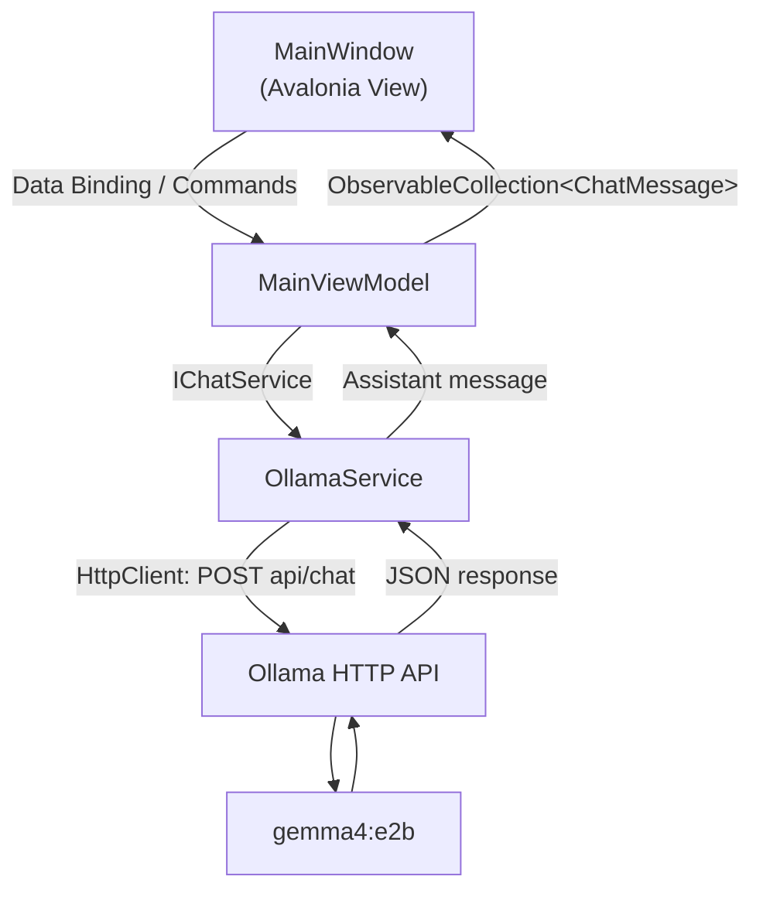

# LocalLlmDesktop

[English README](README.md)

*本プロジェクトは、ローカルで稼働する言語モデルのデスクトップクライアントを開発する個人学習プロジェクトです。*

## Description（概要）

LocalLlmDesktopは、C#、.NET、Avalonia UIを使用して開発したデスクトップチャットアプリケーションです。[Ollama](https://ollama.com/)が提供するHTTP APIを通じて、言語モデルにメッセージを送信するためのGUIを提供します。

本アプリケーションは、独立したクライアントとして設計しています。言語モデル自体をアプリケーションに内包するのではなく、別プロセス・別サービスとして稼働するOllamaがモデルの管理と推論処理を担います。LocalLlmDesktopは会話履歴をOllamaに送信し、返却された応答を画面に表示します。

本プロジェクトの主な学習目的は、デスクトップアプリケーション開発、MVVMパターン、依存性注入、インターフェースによるサービスの抽象化、非同期HTTP通信、.NETによるクロスプラットフォーム向けPublishを実践的に理解することです。

## Features（主な機能）

- Ollamaの`/api/chat`エンドポイントを通じたテキストメッセージの送信
- ユーザーとアシスタントのメッセージ表示
- 後続のリクエストへの会話履歴の引き継ぎ
- 非同期HTTP通信
- UI上でのリクエスト状態およびエラー表示
- 複数のランタイムターゲット向けPublish

### 現在の実装範囲

現時点の実装には、以下の特徴・制約があります。

- 使用モデルは`gemma4:e2b`に固定
- 応答方式は非ストリーミング（`stream: false`）
- Ollamaの接続先URLは`App.axaml.cs`に直接記述
- 会話履歴はメモリ上に保持し、アプリケーション終了後には保存されない

モデル選択、ストリーミング表示、会話履歴の永続化、接続先の設定機能は未実装です。

## Technology Stack（技術スタック）

| 技術 | 用途 |
|---|---|
| C# | アプリケーション開発言語 |
| .NET 10 | 実行環境・アプリケーション基盤 |
| Avalonia UI 12.1.6 | クロスプラットフォーム対応デスクトップUI |
| CommunityToolkit.Mvvm 8.4.2 | MVVMのソースジェネレーターおよびCommand機能 |
| `HttpClient` | OllamaとのHTTP通信 |
| `System.Text.Json` | JSONのシリアライズ・デシリアライズ |
| Ollama | ローカルモデルの管理・推論サーバー |
| gemma4:e2b | 現在設定されている言語モデル |

## Requirements（動作要件）

- .NET 10 SDK（ソースからビルドする場合）
- インストール済みで稼働中のOllama
- Ollamaで利用可能な`gemma4:e2b`モデル
- 対象ランタイムに対応したデスクトップ環境

言語モデルはOllama側で管理します。このリポジトリやアプリケーションのPublish成果物には含まれません。

## Instructions（導入・実行手順）

### 1. Ollamaのインストールと準備

[Ollama公式サイト](https://ollama.com/)の手順に従ってインストールします。

現在の実装で使用するモデルを取得します。

```bash
ollama pull gemma4:e2b
```

アプリケーションを起動する前にOllamaが稼働していることを確認してください。OSやインストール方法によっては、Ollamaがバックグラウンドサービスとして自動起動します。

### 2. Ollamaの接続先を設定する

現在のソースコードでは、`App.axaml.cs`に接続先を直接設定しています。

```csharp
_httpClient = new HttpClient
{
    BaseAddress = new Uri("http://172.27.192.1:11434/")
};
```

このアドレスは、開発環境においてWSL2からWindowsホスト上のOllamaに接続するために使用したものです。環境固有のアドレスであり、別のPCやネットワーク構成でも利用できるとは限りません。

アプリケーションの実行プロセスから到達可能なURLに変更してください。例えば、アプリケーションとOllamaを同じホスト上で実行する場合、接続先は次のようになります。

```csharp
BaseAddress = new Uri("http://127.0.0.1:11434/");
```

WSL2内のアプリケーションからWindows上のOllamaに接続する場合は、OllamaがWSL2から到達可能なアドレスで待ち受けるように設定し、対応するWindowsホスト側のアドレスを指定する必要があります。Ollama APIを信頼できないネットワークに公開しないでください。

アプリケーションは、このベースURLに対して相対パス`api/chat`へリクエストを送信します。

### 3. ソースコードからビルド・実行する

リポジトリを取得します。

```bash
git clone <repository-url>
cd LocalLlmDesktop
```

依存関係を復元し、ビルドします。

```bash
dotnet restore
dotnet build
```

アプリケーションを起動します。

```bash
dotnet run
```

メッセージを送信する前に、設定したOllamaの接続先に到達できること、および`gemma4:e2b`モデルが利用可能であることを確認してください。

### 4. Publish（配布用ビルド）

以下はWindowsおよびLinux向けのReleaseビルド例です。

Windows・Framework-dependent deployment（FDD）：

```powershell
dotnet publish -c Release -r win-x64 --self-contained false -o .\artifacts\win-x64-fdd
```

Windows・Self-contained deployment（SCD）：

```powershell
dotnet publish -c Release -r win-x64 --self-contained true -o .\artifacts\win-x64-scd
```

Linux・Self-contained deployment（SCD）：

```bash
dotnet publish -c Release -r linux-x64 --self-contained true -o ./artifacts/linux-x64-scd
```

FDDでは、実行先に互換性のある.NETランタイムが必要です。SCDでは対象ランタイム向けの.NETランタイムを成果物に含めますが、Ollamaや言語モデルは含みません。また、UIフレームワークが必要とするOS固有のネイティブライブラリは、別途インストールが必要になる場合があります。

### 5. WSL2 / WSLgに関する補足

開発時には、WSLg環境でLinux版アプリケーションを起動し、Windowsホスト上で稼働するOllamaとの通信を確認しました。

その環境では、不足していたネイティブライブラリへの対応として以下をインストールしました。

```bash
sudo apt install libice6 libsm6
```

これは開発環境での対応記録であり、すべてのLinuxディストリビューションやデスクトップ環境に共通する完全な依存パッケージ一覧ではありません。

WSLg上でのアプリケーションへの日本語入力は、開発時点では正常動作を確認できていません。原因の切り分けも完了していないため、アプリケーション側の不具合と断定せず、既知の未解決事項として扱っています。

## Architecture（アーキテクチャ）

本アプリケーションは、UI、画面表示に関するロジック、サービスの抽象化、OllamaとのHTTP通信処理を分離しています。



### 主要コンポーネント

| コンポーネント | 責務 |
|---|---|
| `MainWindow` | チャット画面を表示し、ViewModelとUI要素をBindingで接続 |
| `MainViewModel` | 入力、会話履歴、Commandの実行可否、リクエスト状態を管理 |
| `IChatService` | アプリケーションが必要とするチャットサービスの契約を定義 |
| `OllamaService` | チャットリクエストの構築、Ollamaへの送信、レスポンスの解析 |
| `ChatMessage` | RoleとContentを持つメッセージを表現 |
| `OllamaChatRequest` | Ollamaに送信するJSONリクエストを表現 |
| `OllamaChatResponse` | Ollamaから受信するJSONレスポンスを表現 |

## Resources（参考資料）

- [Ollama Documentation](https://docs.ollama.com/)
- [Ollama API Documentation](https://docs.ollama.com/api)
- [Avalonia Documentation](https://docs.avaloniaui.net/)
- [Microsoft .NET Documentation](https://learn.microsoft.com/dotnet/)
- [CommunityToolkit.Mvvm Documentation](https://learn.microsoft.com/dotnet/communitytoolkit/mvvm/)

## How to Use AI（AIの活用方法）

本プロジェクトでは、AIツールを学習および開発支援のために利用しました。

- **概念の理解：** MVVM、データバインディング、依存性注入、インターフェース、非同期処理、HTTP通信などの概念を理解するために説明を参照しました。
- **実装支援：** 実装方法の検討や、フレームワーク・APIの利用方法の理解にAIの助言を利用しました。
- **デバッグ：** ビルドエラー、実行時の挙動、接続問題について原因を検討する際に利用し、提案された解決策は実際の開発環境で確認しました。
- **レビューと文書化：** 技術的な説明の整理、アーキテクチャや設計判断の文書化に利用しました。

AIの提案は正しさの証明として扱わず、検証すべき情報として扱いました。可能な範囲でビルドや実行テストを行い、実装の挙動を確認しています。

## Advanced（発展的な設計・技術解説）

### Design Decisions（設計判断）

#### 1. アプリケーションと言語モデルを分離する

**Decision（判断）：** デスクトップアプリケーションは、独立して稼働するOllamaサービスのクライアントとして設計しました。言語モデル自体はアプリケーションに内包していません。

**Reasoning（理由）：** モデルファイルは大容量になる場合があり、インストールやライフサイクルもアプリケーション本体とは異なります。モデル管理をOllamaに委ねることで、デスクトップアプリケーションの配布物を特定のモデルに依存させずに済みます。また、UIとは独立して推論処理を管理できます。

**Trade-off（トレードオフ）：** Ollamaを別途インストール・起動する必要があり、アプリケーションから到達可能なAPI接続先を設定しなければなりません。

#### 2. MVVMによってUIと画面表示ロジックを分離する

**Decision（判断）：** AvaloniaとModel-View-ViewModel（MVVM）パターンを採用しました。

**Reasoning（理由）：** `MainWindow`は画面表示を担当し、`MainViewModel`はUIの状態やユーザー操作を管理します。両者をData Bindingで接続することで、Viewにチャット処理の中心的なロジックを持たせずに済みます。

`CommunityToolkit.Mvvm`の`[ObservableProperty]`や`[RelayCommand]`などの属性を利用し、変更通知を行うプロパティやCommandの定型的な実装をソースジェネレーターに委ねています。

**Trade-off（トレードオフ）：** Data Binding、プロパティ変更通知、Command実行、ViewとViewModelの関係を理解する必要があります。

#### 3. インターフェースを介してチャット処理を抽象化する

**Decision（判断）：** `MainViewModel`は`OllamaService`に直接依存せず、`IChatService`に依存します。

**Reasoning（理由）：** インターフェースによって、ViewModelが必要とする操作を定義しています。

```csharp
Task<string> GenerateResponseAsync(
    IReadOnlyList<ChatMessage> messages,
    CancellationToken cancellationToken = default
);
```

これにより、画面表示ロジックとOllama固有の実装との直接的な結合を弱めています。同じ契約を満たす別のサービス実装を用意すれば、ViewModel側の依存型を変更せずに実装を差し替えられます。

**Trade-off（トレードオフ）：** インターフェースと実装という追加の構造を維持する必要があります。小規模なアプリケーションでは一定のオーバーヘッドになりますが、UIロジックと外部通信の境界を明確にできます。

#### 4. 非同期HTTP通信を利用する

**Decision（判断）：** `OllamaService`では`HttpClient`と非同期メソッドを利用してOllama APIにリクエストを送信します。

**Reasoning（理由）：** モデルの推論には時間がかかる場合があります。HTTP処理を非同期で待機することで、リクエスト処理を同期的にブロックする方式を避けています。サービスでは、リクエストをJSONにシリアライズし、`api/chat`へ送信します。その後、HTTPステータスを確認し、レスポンスをデシリアライズします。

`HttpClient`はアプリケーション初期化時に生成し、デスクトップアプリケーションの終了時に破棄します。

**Trade-off（トレードオフ）：** ネットワーク障害、Ollamaサービスの停止、HTTPエラーへの対応が必要です。現在のViewModelでは例外を捕捉し、エラー内容をステータス表示に反映しています。

#### 5. チャットエンドポイントに会話履歴を送信する

**Decision（判断）：** ViewModel内で`ObservableCollection<ChatMessage>`を使ってメッセージを保持し、リクエストのたびに現在の会話履歴をチャットサービスへ渡します。

**Reasoning（理由）：** `/api/chat`エンドポイントはメッセージのリストを受け取ります。会話履歴を送信することで、各メッセージを独立したプロンプトとして扱うのではなく、過去の発言を文脈として利用できます。

`ObservableCollection<T>`は要素の追加・削除をUIに通知するため、メッセージが追加された際に会話画面へ変更を反映できます。

**Trade-off（トレードオフ）：** 会話履歴は現在メモリ上にのみ保持されます。また、リクエストごとに全履歴を送信するため、会話が長くなるほどリクエストサイズも増加します。永続化や履歴管理機能は未実装です。

#### 6. 初期実装では非ストリーミング応答を採用する

**Decision（判断）：** リクエストの`stream`を`false`に設定しています。

**Reasoning（理由）：** 非ストリーミング通信では、リクエストを送信し、応答全体を受信してからアシスタントのメッセージを追加するという単純な処理フローを構成できます。

**Trade-off（トレードオフ）：** モデルが生成している途中のトークンを逐次表示できません。ストリーミングは今後の改善候補です。

### Deployment: FDD vs. SCD（配布方式の比較）

.NETには複数の配布方式があります。

| 方式 | 説明 | 留意点 |
|---|---|---|
| Framework-dependent deployment（FDD） | .NETランタイムを同梱せずにアプリケーションをPublish | 実行先に互換性のあるランタイムが必要 |
| Self-contained deployment（SCD） | 対象ランタイム向けの.NETランタイムを同梱 | 成果物のサイズが大きくなる。Ollamaなどの外部サービスは含まれない |

開発時にはWindows（`win-x64`）とLinux（`linux-x64`）向けにPublishしました。ただし、対象ランタイムを指定してPublishするだけで、OS固有の依存関係や環境固有の接続設定まですべて満たされるわけではありません。

### Cross-Platform Considerations（クロスプラットフォーム対応に関する考察）

Avaloniaは複数のデスクトッププラットフォームをサポートしており、.NETのPublishでは異なるRuntime Identifierを指定できます。しかし、フレームワークがクロスプラットフォームに対応していることと、特定の環境でアプリケーションが正常動作することは別の問題です。

本プロジェクトでは、WSLg上でLinux版アプリケーションを起動し、Windowsホスト上で稼働するOllamaとの通信を確認しました。設定されているベースURL（`172.27.192.1`）は、このWSL2開発環境に対応したものです。汎用的なアドレスではないため、別の環境では変更が必要です。

また、アプリケーションはOSが提供するネイティブライブラリにも依存します。WSLgでのテストでは`libice6`と`libsm6`のインストールが必要でした。

### Limitations and Future Improvements（制約と今後の改善候補）

現在の実装範囲外である項目は以下のとおりです。

- ハードコードされた接続先URLの設定可能化
- 固定モデル名からモデル選択機能への拡張
- ストリーミング応答
- 会話履歴の永続化
- 会話の作成・削除・履歴管理
- 接続処理およびエラー処理の拡充
- WSLg上での日本語入力動作の検証

これらは今後の改善候補であり、現時点で実装済みの機能ではありません。
